# Appendix B. Figures

The images carry no result or figure numbers; the text cites each one as Figure B.n. Rendered from `register/figures.yaml`. Images are in `figs_thesis/`.

**Figure B.1.** Left: a schematic piecewise strictly monotone curve sigma^2(theta) on theta in [0, 10] (a sum of three Gaussian bumps and a logistic step; no filtering parameters), its endpoint limits and turning-point values as dotted horizontal lines (the critical tolerances), turning points marked, and the failure set at the dashed tolerance R^2 = 1.25 shaded. Right: the class read off in each band between consecutive critical tolerances.

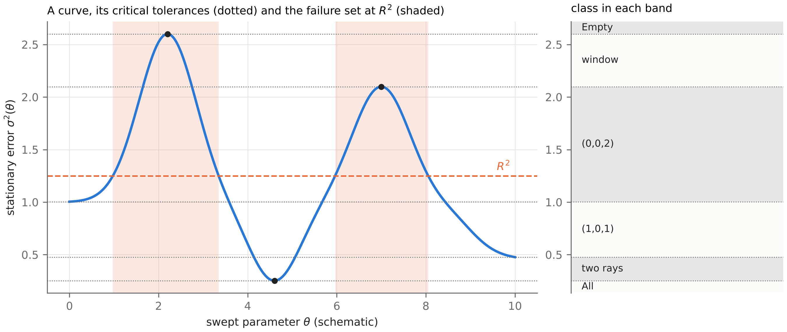

**Figure B.2.** The (nu, q) plane, nu = 2 Sigma Pi/lambda^2 on a log axis from 1e-2 to 1e3 and q = G/(F Pi) from 0 to 5: the floor crossing q = 2, the optimal envelope q*(nu) = 2/(1 + sqrt(1 + nu)) (where the optimal variance ratio equals q*), and the tolerance boundaries V(nu, q) = R^2_rel for R^2_rel = 0.5, 1 and 2, with the point (nu_R, 0.5) where the R^2_rel = 0.5 boundary touches the envelope marked; only q >= 0 is drawn.

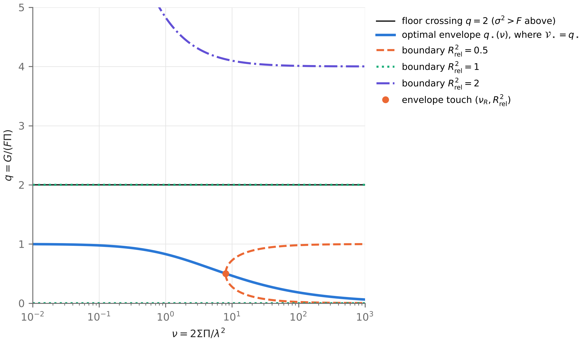

**Figure B.3.** sigma^2 (log scale) at lambda = c = 1, Sigma = 0.01 along three design sweeps: (a) the prior sweep over Pi_0 from 1e-2 to 1e5 at Pi = 1 (case P3, U-shaped, with F, V_c, the minimum sigma*^2 and Pi_0* marked and a zoom inset near the minimum); (b) the prior sweep at Pi = 500 (case P1, monotone, with F and V_c marked); (c) the coupling sweep over c from 1e-4 to 10 at Pi = Pi_0 = 1, with F, sigma*^2, c* and c_F marked and a zoom inset.

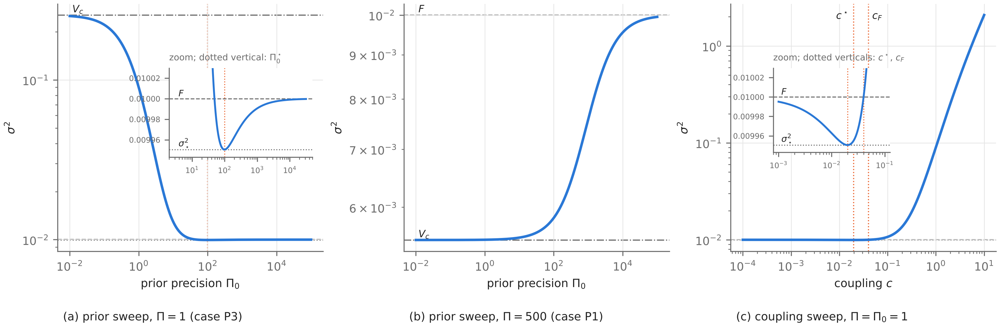

**Figure B.4.** sigma^2 against precision Pi (log axis) at lambda = 1, Sigma = 0.01 (F = 0.01): the optimal envelope sigma*^2(Pi) with the region below it shaded as unreachable, a Bayesian-weight base curve (kappa = 1.5) with three compactly supported bumps of peak 1.5F placed before the envelope touch point Pi_c = 56.20, the tolerance R^2 = 1.25F (three windows) and the tolerance R^2 = 0.6F with the forced lower ray (0, pi_R), pi_R = 222.2, marked.

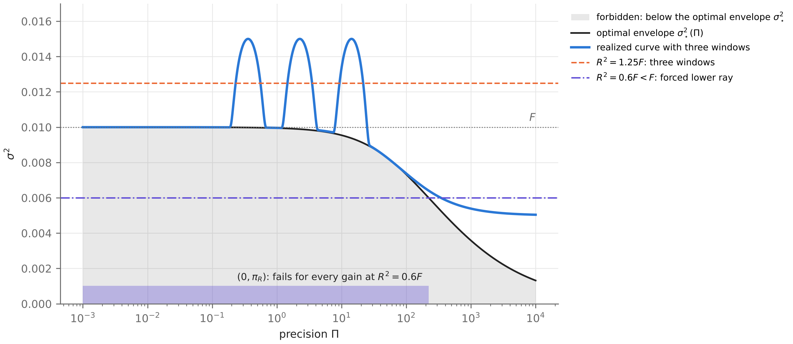

**Figure B.5.** Peak variance M/F against the initial over-weighting x for the Bayesian-weight gain (x = kappa) and the misspecified Kalman gain (x = F'/F) at lambda = lambda' = c = 1, Sigma = 0.01; both rise from 1 at x = 2, and the end values at x = 100 (9.2875 and 17.575) are annotated.

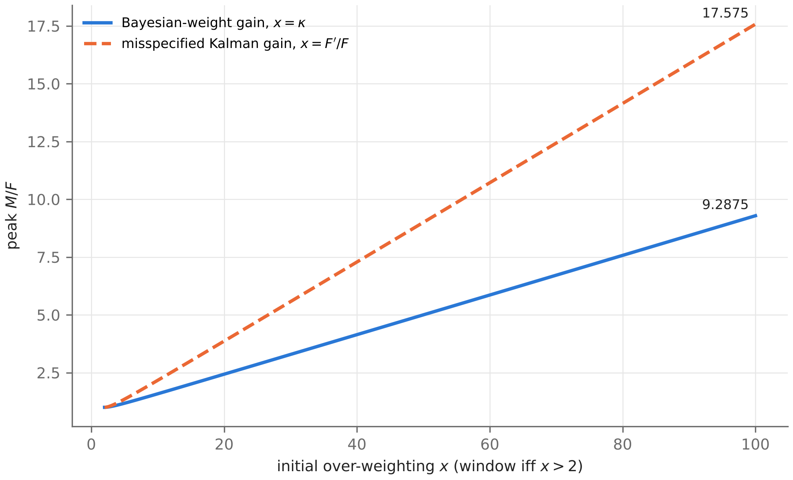

**Figure B.6.** Hill gain with n = 2 at lambda = c = 1, Sigma = 0.01: over the half-saturation Pi_0 (log axis), the turning-point values m/F (dashed) and M/F (solid) as tolerances R^2/F, the band m <= R^2 < min(M, F) shaded as the mixed class lower ray + window and the band F <= R^2 < M shaded as window, with vertical lines at the pair birth Pi_0^pair = 31.475 and the window onset c lambda/(4 Sigma) = 25.

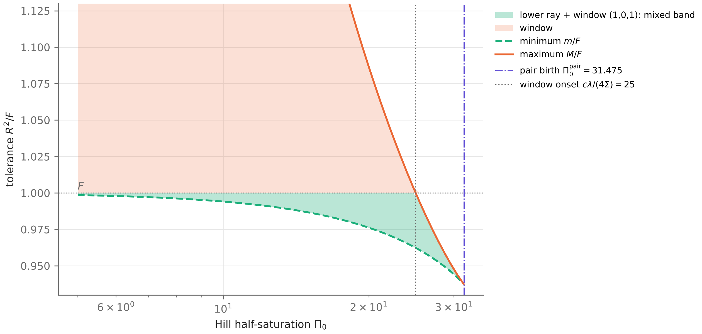

**Figure B.7.** Stationary error against correlation time tau (log axes) at lambda = 1, Sigma = 0.01, Pi = 1 for the relay with G = 0.5 and the optimal filter. Left, matched zero-frequency power: both decrease, with F marked. Right, matched variance v = 0.05: the relay increases and the optimal error is unimodal with maximum P_max = 0.008333 at tau = 1/lambda; the optimal-filter failure set at R^2 = 0.8 P_max is shaded.

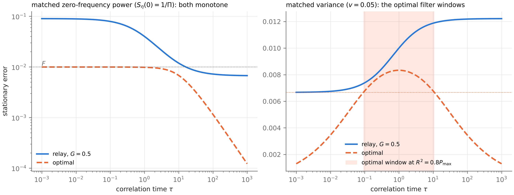

**Figure B.8.** Optimal error against the sampling interval Delta t (log axis) in the point-sampled model at lambda = 1, Sigma = 0.01, Pi = 1 (per-sample noise variance 1/(Pi Delta t)): the error at sample times (post) falls from sigma*^2 towards 0, while the prior error and the time average rise from sigma*^2 to F; sigma*^2 and F are marked.

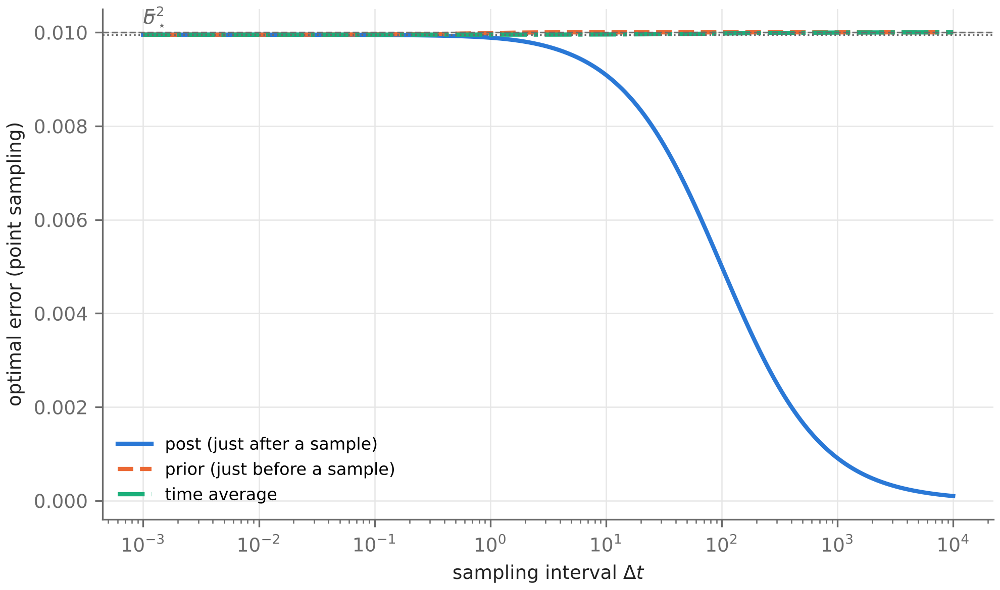

**Figure B.9.** Sampled relay D1 (gain 1 - exp(-G Delta t), G = 0.5, lambda = 1, Sigma = 0.01, Pi = 1) along Delta t (log axis). Left: the error at sample times with the window band R^2 in (0.09, 0.20457) shaded and the excess crossing Delta t_E = 100 marked. Right: the time average as avg/F - 1 on a symmetric-log axis, with the two-ray band between its minimum and F shaded and Delta t_E marked.

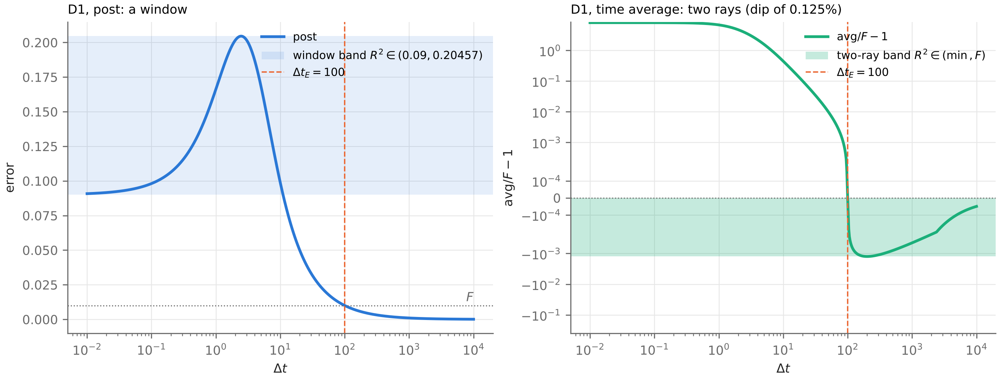

**Figure B.10.** The process-noise sweep at lambda = Pi = 1, against u = 2 Sigma Pi/lambda^2 (log axes), for the Sigma-independent gain (G = 1), the Sigma-tracking gain over-trusting precision by rho = 10, and the optimal filter. Left: absolute error. Right: relative error sigma^2/F, where the over-trusting gain rises above 1 to a peak of about 2.17 before falling.

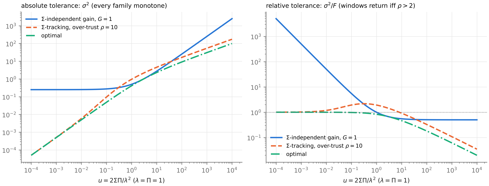

**Figure B.11.** Colour map of the optimal error relative to its supremum over tau, P/sup P, for the power-normalised family S = K tau^beta/(1 + tau^2 omega^2) at lambda = 1, Sigma = 0.01, K = 1, over the exponent beta (horizontal) and log10(lambda tau) (vertical); the position of the single maximum for 0 < beta < 2 is drawn, and the three regimes (ordered with information increasing in tau; spectra cross; ordered with information decreasing in tau) are labelled in words.

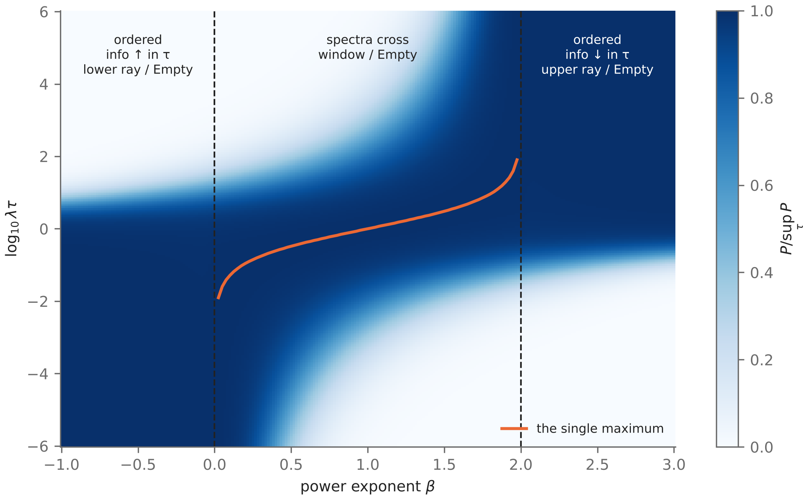

**Figure B.12.** Optimal filtering error P(d(theta)) for observations delayed by d(theta) = theta exp(-theta), at lambda = 1, Sigma = 0.01, Pi = 1, against theta (log axis): it rises from sigma*^2 = 0.0099505 to P(1/e) = 0.0099763 at theta = 1 and falls back; the optimal-filter failure set at R^2 = 0.0099634 is shaded, and theta = 1, where the causal order reverses, is marked.

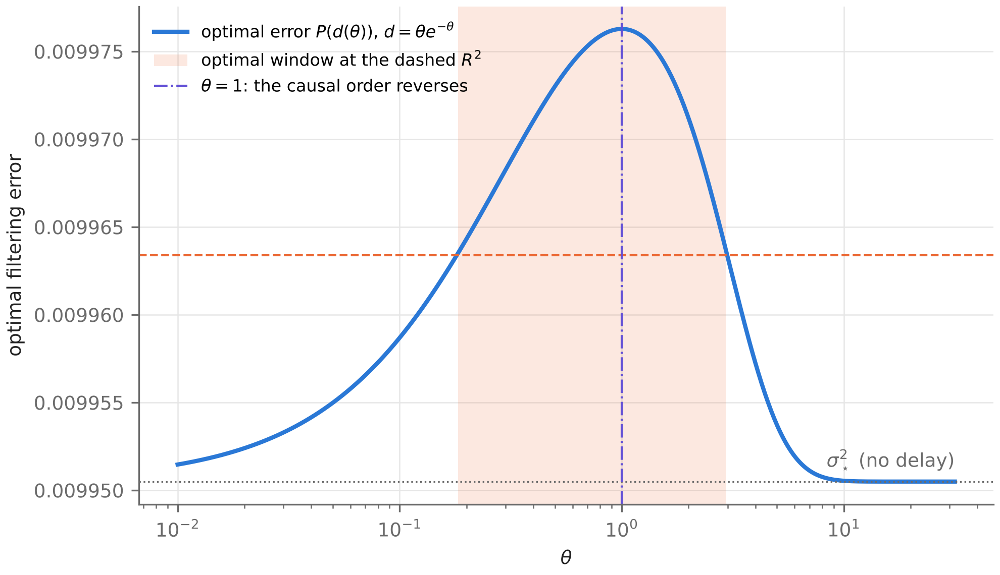
