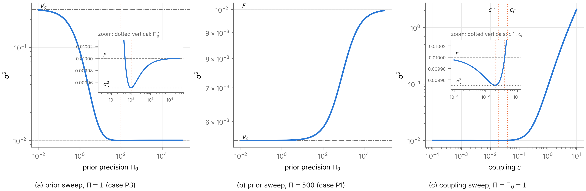

# Task 8 — Stage 0–1 classification checks

Verifies `Stage_0_1_Classification_Results.md` (copied into this directory unchanged). Pre-registration: `PREREG_t8.md`, commit **d8fa786**. Final commit: **(not yet committed)**. Total runtime of `run_all.sh`: **160.7 s** (Python 3.13.16, NumPy 2.5.3, SciPy 1.18.1, SymPy 1.14.0, Matplotlib 3.11.2). Generated from `results/t8.txt` and `results/t8_*.json` by `t8_report.py`.

## Verdicts

| Criterion | Verdict | Measured |
|---|---|---|
| T8.1 analytic (SymPy) | PASS | every identity `simplify` → 0 (no numeric-only fallbacks); Paper 1 limiting case M = 0.092875 at Π* = 0.6867, four-regime table 13/13 |
| T8.2 worked-example values | PASS | 14/14 values match to 4 s.f. |
| T8.3 classification tables | PASS | 62/62 predicted classes match (P1, P2, P3, Π_B, Π_A, coupling) |
| T8.4 Theorem 3.2, adversarial | PASS | 1,000,000 classifications over 100,000 sweeps: 0 windows or mixed classes; 0 interior local maxima found |
| T8.5 Proposition 1.1 realizability | PASS | 21/21 classes |
| T8.6 figure | DONE | `figures/fig_t8_sweeps.png` (300 dpi) |

**Overall: all criteria pass.**

## Finding: the C4 parenthetical has the directions reversed

C4 defines approach *from above* as σ² > L on the adjacent piece, then adds: "from above at θ₋ means the first piece is decreasing, and from above at θ₊ means the last piece is increasing." That parenthetical is backwards: a first piece lying above L₋ rises away from θ₋ (increasing), and a last piece lying above L₊ falls towards θ₊ (decreasing). Evidence (T8.1(h)): on the Paper 1 sweep the first piece is increasing (direction +1) with σ² − F = 0.0276 > 0 one decade below Π*, and the last piece is decreasing (direction -1) with σ² − H = 0.03 > 0 one decade above, so both ends are approached from above in the sense of the definition (and of the document's own Paper 1 check). Every other use in the document (Theorem 1.2(b) and its proof, Propositions 4.1, 4.2, 5.1, 5.2, the synthesis matrix) follows the definition, so no stated class is affected. Suggested wording: "from above at θ₋ means the first piece is increasing, and from above at θ₊ means the last piece is decreasing."

## Bugs fixed during the run (genuine bugs, no criterion or tolerance changed)

1. **Approach-direction labels.** The classifier first labelled approach directions using the C4 parenthetical, so T8.1(h) reported both Paper 1 ends as "below" and failed its structure check, while all 13 classes matched (classes are computed from piece directions and end values, not from the labels). The labels were changed to follow the C4 definition (σ² vs L on the adjacent piece). This is the finding above.
2. **Overflow at the endpoint limits.** `σ²(θ)` at θ = 10²⁵⁰ raised a Python `OverflowError` (G² for the coupling sweep) instead of returning ∞. θ is now formed as a NumPy float64 and ∞ is capped at 1e300 inside root-finding. T8.3 crashed before any coupling-sweep class was computed; no class changed.

A 200-set run of `t8_no_window.py` (same seed; the first 200 of the 20,000 sets) was made to check the code runs and to time it; it found no window, and nothing was changed afterwards.

## Method notes

- The classifier (`t8_common.py`) finds turning points as brentq-refined sign changes of the analytic derivative on a log grid (40 points per decade, θ ∈ [1e-60, 1e60]), takes endpoint limits at θ = 1e∓250 (checked against 1e∓200), and builds the failure set piece by piece from the end values, locating every crossing by brentq on the monotone piece. Grid membership is never used to decide a class.
- "R² equals a critical value" is recognised to 1e-12 relative (floating point); the ±1e-6 tests are far outside it.
- Minima in T8.2 come from `minimize_scalar(method='bounded')` over log10 θ ∈ [−6, 6].

## Full results

```
Task 8 — Stage 0–1 classification checks
prereg commit d8fa786; final commit (not yet committed); total runtime 160.7 s

[PASS] T8.1 analytic (SymPy 1.14.0)
    (a) [PASS] (simplify) d sigma2/dG - (G^2+2 lam G-2 Sig Pi)/(2 Pi (lam+G)^2) == 0
    (b) [PASS] (solve) roots are exactly -lam +/- s
    (b) [PASS] (assumptions) -lam - s < 0
    (b) [PASS] (simplify) G* - 2 Sig Pi/(lam+s) == 0
    (b) [PASS] (assumptions) 2 Sig Pi/(lam+s) > 0 (so G* > 0: exactly one positive root)
    (b) [PASS] (simplify) sigma2(G*, Pi) - G*/Pi == 0
    (b) [PASS] (simplify) F - G*/Pi - 2 Sig^2 Pi/(lam (lam+s)^2) == 0
    (b) [PASS] (assumptions) 2 Sig^2 Pi/(lam (lam+s)^2) > 0 (so G*/Pi < F)
    (c) [PASS] (simplify) sigma2 - F - G (lam G/(2 Pi) - Sig)/(lam (lam+G)) == 0
    (c) [PASS] (solve) zeros of the excess at G = 0 and G = 2 F Pi  SymPy: [0, 2*Pi*Sigma/lambda]
    (d) [PASS] (simplify) G(Pi0*) - G* == 0 at Pi0* = Pi (c/G* - 1)
    (d) [PASS] (simplify) c - G* - 2 Sig (Pi_A - Pi)/(c+lam+s) == 0
    (d) [PASS] (assumptions) c + lam + s > 0
    (d) [PASS] (simplify) c - 2 F Pi - 2 F (Pi_B - Pi) == 0
    (d) [PASS] (simplify) Pi_A - Pi_B - c (c+lam)/(2 Sig) == 0
    (d) [PASS] (assumptions) c (c+lam)/(2 Sig) > 0 (Pi_B < Pi_A)
    (d) [PASS] (simplify) V_c - F - c (c - 2 F Pi)/(2 Pi (lam+c)) == 0
    (d) [PASS] (assumptions) c/(2 Pi (lam+c)) > 0 (V_c > F iff c > 2 F Pi)
    (e) [PASS] (simplify) c* K - G* == 0
    (e) [PASS] (simplify) c* - (Pi+Pi0)(s - lam)/Pi == 0
    (e) [PASS] (simplify) c_F - 2 F (Pi+Pi0) == 0
    (e) [PASS] (simplify) sigma2(c_F K, Pi) - F == 0
    (f) [PASS] (limit) prior, Pi0 -> 0+  SymPy: (Sigma + c**2/(2*Pi))/(c + lambda)
    (f) [PASS] (limit) prior, Pi0 -> oo  SymPy: Sigma/lambda
    (f) [PASS] (limit) coupling, c -> 0+  SymPy: Sigma/lambda
    (f) [PASS] (limit) coupling, c -> oo  SymPy: oo
    (g) [PASS] (simplify) lim_{Pi0->oo} Pi0^2 d sigma2/dPi0 - c Pi Sig/lam^2 == 0 (sympy: Pi*Sigma*c/lambda**2)
    (g) [PASS] (assumptions) c Pi Sig/lam^2 > 0 (F approached from below)
    (g) [PASS] (simplify) lim_{Pi0->0} d sigma2/dPi0 + c (c^2+2 lam c-2 Sig Pi)/(2 Pi^2 (lam+c)^2) == 0
    (g) [PASS] (simplify) c^2+2 lam c-2 Sig Pi - (c - G*)(c+lam+s) == 0 (sign = sign(c - G*))
    (g) [PASS] (simplify) lim_{c->0} d sigma2/dc + K Sig/lam^2 == 0
    (g) [PASS] (assumptions) -K Sig/lam^2 < 0 (F approached from below)
    (h) [PASS] Paper 1 sweep, Pi0 = 1: turning points [[0.6866954098747663, 0.09287527205297114, 'max']]; L- = 0.01 (above), L+ = 0.005 (above)
    (h) [PASS] M = 0.09287527 (stated 0.09288), Pi* = 0.6866954 (stated 0.6867)
    (h) [PASS] four-regime table: 13/13 classes match
    (h) C4 wording: first piece direction +1 with sigma2 - L- = 0.02765; last piece direction -1 with sigma2 - L+ = 0.02996
    identities confirmed by simplify: all; numeric-only fallbacks: 0

[PASS] T8.2 worked-example values (4 s.f.)
    Pi_B                           computed 50  stated 50.0  ok
    Pi_A                           computed 150  stated 150.0  ok
    Pi=1: G*                       computed 0.0099504938  stated 0.00995  ok
    Pi=1: Pi0*                     computed 99.49752  stated 99.5  ok
    Pi=1: sigma*^2                 computed 0.0099504938  stated 0.00995  ok
    Pi=1: V_c                      computed 0.255  stated 0.255  ok
    Pi=60: Pi0*                    computed 64.161985  stated 64.16  ok
    Pi=60: sigma*^2                computed 0.008053995  stated 0.008054  ok
    Pi=60: V_c                     computed 0.0091666667  stated 0.009167  ok
    Pi=500: no interior extremum   computed {'turning_points': 0, 'argmin_log10': -5.999999847736574}  stated none  ok
    Pi=500: V_c                    computed 0.0055  stated 0.0055  ok
    coupling: c*                   computed 0.019900987  stated 0.0199  ok
    coupling: sigma*^2             computed 0.0099504938  stated 0.00995  ok
    coupling: c_F                  computed 0.04  stated 0.04  ok

[PASS] T8.3 classification tables: 62/62 classes match
    Prop 4.2 P1 (Pi = 500): PASS; turning points []; approach above / below
       row R2 <= V_c (interior)   R2 = 0.00275: All (expected All)
       row V_c<R2<F (interior)    R2 = 0.00775: upper ray (expected upper ray)
       row R2 >= F (interior)     R2 = 0.015: Empty (expected Empty)
       V_c exact                  R2 = 0.0055: All (expected All)
       V_c x(1-1e-6)              R2 = 0.0054999945: All (expected All)
       V_c x(1+1e-6)              R2 = 0.0055000055: upper ray (expected upper ray)
       F exact                    R2 = 0.01: Empty (expected Empty)
       F x(1-1e-6)                R2 = 0.00999999: upper ray (expected upper ray)
       F x(1+1e-6)                R2 = 0.01000001: Empty (expected Empty)
    Prop 4.2 P2 (Pi = 60): PASS; turning points [(64.16198487, 0.008053995, 'min')]; approach below / below
       row R2 < s*^2 (interior)   R2 = 0.004026997478: All (expected All)
       row s*^2<R2<V_c (interior) R2 = 0.008610330812: two rays (expected two rays)
       row V_c<=R2<F (interior)   R2 = 0.009583333333: upper ray (expected upper ray)
       row R2 >= F (interior)     R2 = 0.015: Empty (expected Empty)
       sigma*^2 exact             R2 = 0.008053994957: two rays (expected two rays)
       sigma*^2 x(1-1e-6)         R2 = 0.008053986903: All (expected All)
       sigma*^2 x(1+1e-6)         R2 = 0.008054003011: two rays (expected two rays)
       V_c exact                  R2 = 0.009166666667: upper ray (expected upper ray)
       V_c x(1-1e-6)              R2 = 0.0091666575: two rays (expected two rays)
       V_c x(1+1e-6)              R2 = 0.009166675833: upper ray (expected upper ray)
       F exact                    R2 = 0.01: Empty (expected Empty)
       F x(1-1e-6)                R2 = 0.00999999: upper ray (expected upper ray)
       F x(1+1e-6)                R2 = 0.01000001: Empty (expected Empty)
       [ok] at R2 = sigma*^2 the rays meet at 64.16198487 / 64.16198487 (expected 64.16198487)
    Prop 4.2 P3 (Pi = 1): PASS; turning points [(99.49752469, 0.0099504938, 'min')]; approach below / below
       row R2 < s*^2 (interior)   R2 = 0.004975246918: All (expected All)
       row s*^2<R2<F (interior)   R2 = 0.009975246918: two rays (expected two rays)
       row F<=R2<V_c (interior)   R2 = 0.1325: lower ray (expected lower ray)
       row R2 >= V_c (interior)   R2 = 0.3825: Empty (expected Empty)
       sigma*^2 exact             R2 = 0.009950493836: two rays (expected two rays)
       sigma*^2 x(1-1e-6)         R2 = 0.009950483886: All (expected All)
       sigma*^2 x(1+1e-6)         R2 = 0.009950503787: two rays (expected two rays)
       F exact                    R2 = 0.01: lower ray (expected lower ray)
       F x(1-1e-6)                R2 = 0.00999999: two rays (expected two rays)
       F x(1+1e-6)                R2 = 0.01000001: lower ray (expected lower ray)
       V_c exact                  R2 = 0.255: Empty (expected Empty)
       V_c x(1-1e-6)              R2 = 0.254999745: lower ray (expected lower ray)
       V_c x(1+1e-6)              R2 = 0.255000255: Empty (expected Empty)
       [ok] at R2 = sigma*^2 the rays meet at 99.49752469 / 99.49752469 (expected 99.49752469)
    Prop 4.2 boundary Pi_B (Pi = 50): PASS; turning points [(70.71067812, 0.0082842712, 'min')]; approach below / below
       row R2 < s*^2 (interior)   R2 = 0.004142135624: All (expected All)
       row s*^2<R2<V_c (interior) R2 = 0.009142135624: two rays (expected two rays)
       row R2 >= F (interior)     R2 = 0.015: Empty (expected Empty)
       sigma*^2 exact             R2 = 0.008284271247: two rays (expected two rays)
       sigma*^2 x(1-1e-6)         R2 = 0.008284262963: All (expected All)
       sigma*^2 x(1+1e-6)         R2 = 0.008284279532: two rays (expected two rays)
       F = V_c exact              R2 = 0.01: Empty (expected Empty)
       F = V_c x(1-1e-6)          R2 = 0.00999999: two rays (expected two rays)
       F = V_c x(1+1e-6)          R2 = 0.01000001: Empty (expected Empty)
       [ok] V_c = F to 1e-12 relative (0.01 vs 0.01)
       [ok] at R2 = sigma*^2 the rays meet at 70.71067812 / 70.71067812 (expected 70.71067812)
    Prop 4.2 boundary Pi_A (Pi = 150): PASS; turning points []; approach above / below
       row R2 <= V_c (interior)   R2 = 0.003333333333: All (expected All)
       row V_c<R2<F (interior)    R2 = 0.008333333333: upper ray (expected upper ray)
       row R2 >= F (interior)     R2 = 0.015: Empty (expected Empty)
       V_c exact                  R2 = 0.006666666667: All (expected All)
       V_c x(1-1e-6)              R2 = 0.00666666: All (expected All)
       V_c x(1+1e-6)              R2 = 0.006666673333: upper ray (expected upper ray)
       F exact                    R2 = 0.01: Empty (expected Empty)
       F x(1-1e-6)                R2 = 0.00999999: upper ray (expected upper ray)
       F x(1+1e-6)                R2 = 0.01000001: Empty (expected Empty)
       [ok] c = G* (G* = np.float64(1.0)); no turning point found (0); V_c = sigma*^2 (0.006666666666666667 vs np.float64(0.006666666666666667))
    Prop 5.2 coupling (Pi = Pi0 = 1): PASS; turning points [(0.01990099, 0.0099504938, 'min')]; approach below / n/a (infinite)
       row R2 < s*^2 (interior)   R2 = 0.004975246918: All (expected All)
       row s*^2<R2<F (interior)   R2 = 0.009975246918: two rays (expected two rays)
       row R2 >= F (interior)     R2 = 0.015: upper ray (expected upper ray)
       sigma*^2 exact             R2 = 0.009950493836: two rays (expected two rays)
       sigma*^2 x(1-1e-6)         R2 = 0.009950483886: All (expected All)
       sigma*^2 x(1+1e-6)         R2 = 0.009950503787: two rays (expected two rays)
       F exact                    R2 = 0.01: upper ray (expected upper ray)
       F x(1-1e-6)                R2 = 0.00999999: two rays (expected two rays)
       F x(1+1e-6)                R2 = 0.01000001: upper ray (expected upper ray)
       [ok] R2 = F: upper ray starts at 0.04 (c_F = 0.04)
       [ok] R2 = 1.5F: upper ray starts at c_R = 0.2322374842 >= c_F
       [ok] at R2 = sigma*^2 the rays meet at 0.01990098767 / 0.01990098767 (expected 0.01990098767)

[PASS] T8.4 Theorem 3.2 adversarial (seed 8004): 20000 parameter sets, 100000 sweeps, 1000000 classifications; windows/mixed 0; interior local maxima found 0
    prior (theta = Pi0)      turning points {'1': 11709, '0': 8291}; classes {'Empty': 54278, 'lower ray': 34312, 'two rays': 32242, 'All': 44695, 'upper ray': 34473}; local maxima 0; limit-check failures 0; flat pieces 0
    coupling (theta = c)     turning points {'1': 20000}; classes {'upper ray': 68575, 'two rays': 82728, 'All': 48697}; local maxima 0; limit-check failures 0; flat pieces 0
    c tanh(Pi/Pi0)           turning points {'1': 11709, '0': 8291}; classes {'Empty': 54266, 'lower ray': 34309, 'two rays': 32207, 'All': 44614, 'upper ray': 34604}; local maxima 0; limit-check failures 0; flat pieces 0
    c (1 - exp(-Pi/Pi0))     turning points {'1': 11709, '0': 8291}; classes {'Empty': 54362, 'lower ray': 34310, 'two rays': 32221, 'All': 44650, 'upper ray': 34457}; local maxima 0; limit-check failures 0; flat pieces 0
    c Pi^2/(Pi^2 + Pi0^2)    turning points {'1': 11709, '0': 8291}; classes {'Empty': 54414, 'lower ray': 34255, 'two rays': 32246, 'All': 44767, 'upper ray': 34318}; local maxima 0; limit-check failures 0; flat pieces 0

[PASS] T8.5 realizability: 21/21 intended classes returned at R2 = 1

[DONE] T8.6 figures/fig_t8_sweeps.png

runtime (s): t8_symbolic 1.4, t8_values 0.5, t8_classify 0.5, t8_no_window 156.1, t8_realize 0.5, t8_figures 1.7
```



*Figure: σ² along (a) the prior sweep at Π = 1 (P3), (b) the prior sweep at Π = 500 (P1, monotone) and (c) the coupling sweep at Π = Π₀ = 1, at λ = c = 1, Σ = 0.01. Insets zoom on the minimum, where F and σ*² differ by 0.5%.*
