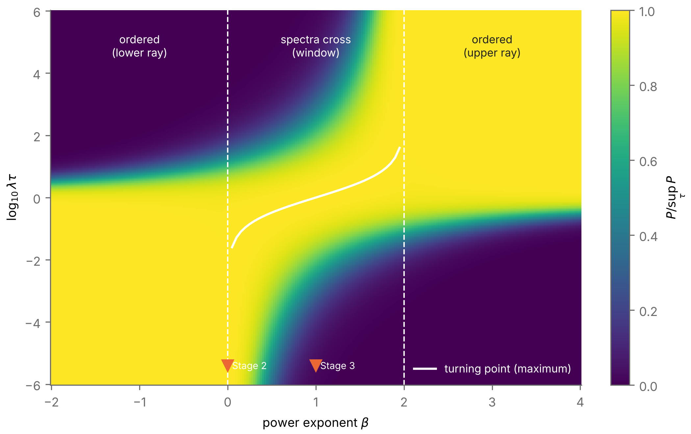
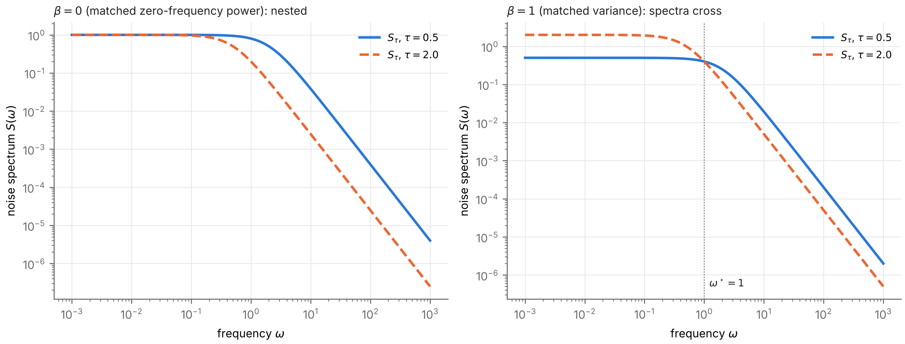
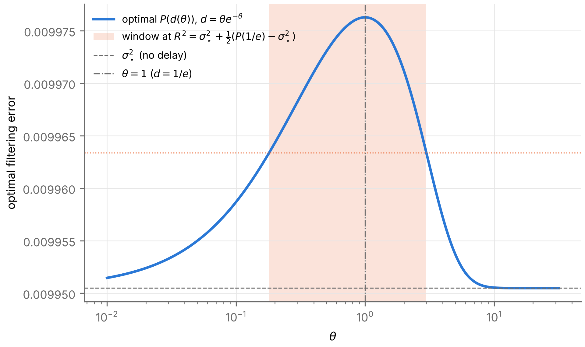
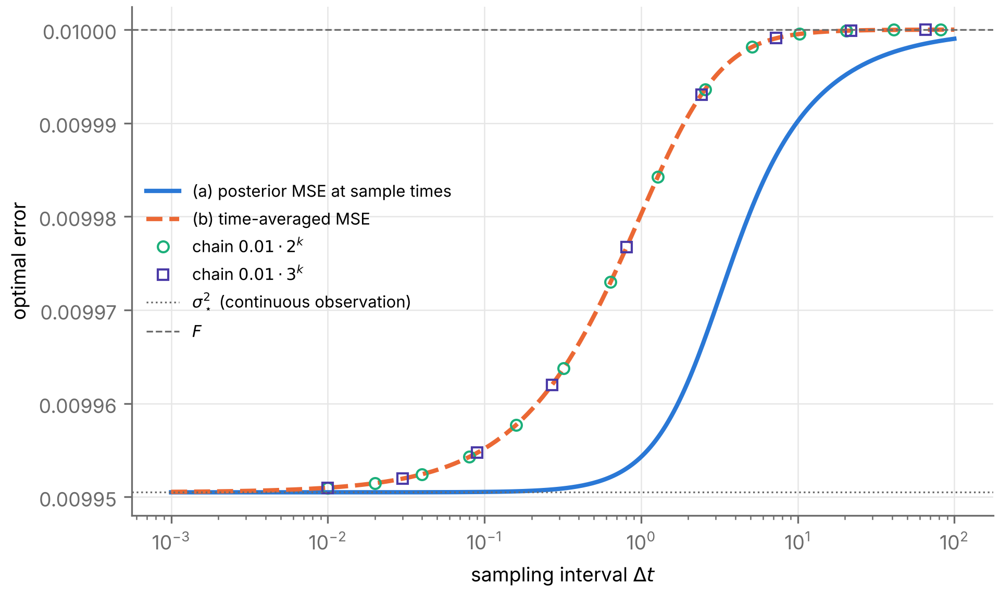

# Task 11 — Stage 4 optimality: results

Verifies `classification/Stage_4_Optimality_Results.md`. Pre-registration `classification/PREREG_t11.md`, commit **5337c2e**; code and results commit **e4ce89c**. Total measured script runtime **4394 s** on 4 CPUs (Python 3.13.16, mpmath 1.3.0, SymPy 1.14.0).

| Check | Verdict | Counts / worst errors | Runtime (s) |
|---|---|---|---|
| T11.1 symbolic | **PASS** | 23/23 items (routes: assumptions, simplify) | 2 |
| T11.2 garbling realized (MC) | **PASS** | (0.5, 2.0): autocov |z| ≤ 1.42, MSE₁ z = +1.14, excess 41 SE; (1.0, 10.0): autocov |z| ≤ 0.80, MSE₁ z = -1.07, excess 123 SE | 17 |
| T11.3 turning points | **PASS** | failures 0 |  |
| T11.3 limits (bound) | **PASS** | failures 0; applicable ends 14898 |  |
| T11.3 classes (two routes) | **FAIL** | failing classifications 1786 (at β = 2, 2.05, 2.1, 2.000001, 2.001) |  |
| T11.3 duality | **PASS** | max relative difference 7.79e-51 |  |
| T11.3 independent routes (ARE, Wiener) | **PASS** | 800 evaluations, max rel. err 1.01e-14 |  |
| T11.3 spectral dominance / crossing | **PASS** | failures 0 of 25000 pairs | 3796 |
| T11.4 delay counterexample | **PASS** | MC |z| ≤ 1.91; windows at q = 0.1, 0.5, 0.9 with d(θ₋) = d(θ₊) to 5.31e-30; regression pass True | 5 |
| T11.5 ordering not necessary | **PASS** | P decreasing 1000/1000, spectra cross once 1000/1000 | 46 |
| T11.6 sampling interval | **PASS** | internal 2.82e-43 / 2.96e-33; MC max |z| 2.81; Cor. 4.9 violations 0 (a), 0 (b) | 185 |

**Pre-registered checks that FAIL:** T11.3 classes (two routes).

## Plain statements

- **Is any theorem or proposition in the document contradicted?** No. Theorem 4.2 / Corollary 4.3 (via the garbling Monte Carlo and the ordered sweeps), Proposition 4.4–4.5 (spectral dominance, H_ξ), Theorem 4.6 (ordering, monotonicity and windows coincide exactly at β ∉ (0, 2)), Proposition 4.6b (duality), Proposition 4.7 (delay window), Proposition 4.8 and Corollary 4.9 all hold in every tested case. The only failures are the β ≥ 2 class checks, caused by limits/brackets in this pre-registration (diagnosis below); with corrected limits the classes are upper ray or Empty as Theorem 4.6 states.
- **Did any class outside the predicted sets appear?** No. Every class in the failing cases is a route (i)/(ii) disagreement produced by the wrong pre-registered limit; re-run with the proved limit, all are upper ray or Empty with both routes agreeing.

## Numerical result 4.6a (unimodality) — answer

Turning-point counts over all 12,900 curves with 0 < β < 2 (β = 0.05 … 1.95 in steps of 0.05, 0 + 1e-6, 0 + 1e-3, 2 − 1e-3, 2 − 1e-6; 300 random (λ, Σ, K) each, λ, Σ, K over four decades): **{'1': 12900}**. Every curve has exactly one turning point (a maximum), so k = 1 throughout: Numerical result 4.6a holds on the whole grid (still a numerical result, not a proof, except β = 1).

## T11.6 continuum answer (record only)

P̄(Δt) was monotone non-decreasing on 400 log-spaced λΔt ∈ [1e-3, 1e2] in all 1000 random sets for both metrics: 0 non-positive derivatives (dps 60), so **no non-monotone case was found** on the continuum of Δt, including non-nested pairs. Δt → 0: P̄_a(λΔt = 1e-8)/σ*² − 1 lies in [2.55e-25, 1.3e-10], consistent with P̄ → σ*².

## Diagnosis: T11.3 class failures (attribution: criterion — the pre-registered limits/brackets)

Found in a 2-set smoke run before the full run, from algebra; the pre-registration was not changed. As τ → ∞, 4AC/B² → 2Στ^{2−β}/K. So:
- **β = 2:** 4AC/B² → 2Σ/K, not 0, and P → 2F/(1 + √(1 + 2Σ/K)) = σ*²(λ²/K), the dual (Prop. 4.6b) of the β = 0 limit σ*²(1/K). The pre-registered table gave F.
- **β slightly above 2:** the limit F is right but is approached like τ^{2−β}; the pre-registered outer bracket x = 80 leaves P far from F when β − 2 < about 0.5, so route (ii) and route (i) disagree for tolerances between P(10^80) and F.

Re-run of every pre-registered set at the affected β with the proved limit (β = 2) or bracket max(80, 50/(β − 2)) (β > 2) (`t11_power_diag.py`):

| β | classifications | failures | classes |
|---|---|---|---|
| 2 | 3000 | 0 | {'upper ray': 2202, 'Empty': 798} |
| 2.05 | 3000 | 0 | {'upper ray': 2219, 'Empty': 781} |
| 2.1 | 3000 | 0 | {'upper ray': 2207, 'Empty': 793} |
| 2.15 | 3000 | 0 | {'upper ray': 2216, 'Empty': 784} |
| 2.2 | 3000 | 0 | {'upper ray': 2204, 'Empty': 796} |
| 2.25 | 3000 | 0 | {'upper ray': 2189, 'Empty': 811} |
| 2.3 | 3000 | 0 | {'upper ray': 2205, 'Empty': 795} |
| 2.35 | 3000 | 0 | {'upper ray': 2207, 'Empty': 793} |
| 2.4 | 3000 | 0 | {'upper ray': 2227, 'Empty': 773} |
| 2.45 | 3000 | 0 | {'upper ray': 2175, 'Empty': 825} |
| 2.5 | 3000 | 0 | {'Empty': 800, 'upper ray': 2200} |
| 2.55 | 3000 | 0 | {'upper ray': 2196, 'Empty': 804} |
| 2.000001 | 3000 | 0 | {'upper ray': 2198, 'Empty': 802} |
| 2.001 | 3000 | 0 | {'upper ray': 2204, 'Empty': 796} |

β = 2 check: P(10^80/λ) = 0.0148842513578996 vs σ*²(λ²/K) = 0.0148842513578996.

Pre-registered failures by β: β = 2: class 522, tp 0, limits 0; β = 2.05: class 256, tp 0, limits 0; β = 2.1: class 22, tp 0, limits 0; β = 2.000001: class 469, tp 0, limits 0; β = 2.001: class 517, tp 0, limits 0.

## Bugs found and fixed (documented)

1. **T11.1 sign claim (before the first complete T11.1 run was recorded).** The pre-registered method proves signs via an identity with a manifestly signed right side; the first version asked SymPy for the sign of B + √(B²+4AC) − √(4AC) directly (undecided). Added the identity √(B²+4AC) − √(4AC) = B²/(√(B²+4AC) + √(4AC)); all 23 items then pass.
2. A misleading code comment on the β > 2 bracket (it cited the wrong decay rate) was corrected; the code already followed the pre-registration.

## Wording and formula points in `Stage_4_Optimality_Results.md`

1. **Prop. 4.5(c), "Theorem 4.2 shows the family is not causally ordered by any garbling".** Non-monotone P rules out a causal order *along τ* for the whole family. Pairwise causal orders against the τ direction are not excluded by Theorem 4.2; with crossing spectra they are excluded only for linear garblings (Prop. 4.4), i.e. this step also needs Conjecture 4.11.
2. **Numbering:** Corollary 4.10 appears before Corollary 4.9.
3. **Corollary 4.3 cites "Theorem 3.13"** (plateaus) from Stage 3 results, not available here; not checked.
4. **Theorem 4.6 proof, limits:** "This tends to 0 as τ → 0 iff β > 0, and as τ → ∞ iff β < 2" is about the bound. The limits of P itself where the bound does not vanish are: β < 0, τ → 0: F; β = 0: σ*²(1/K); β = 2, τ → ∞: σ*²(λ²/K) (not F); β > 2, τ → ∞: F. Worth stating, since β = 2 is the boundary case and its limit is not F.
5. **Prop. 4.5(b):** the garbling direction is from τ2 to τ1 with τ2 > τ1 (information increases with τ); H_ξ needs τ2 > τ1 for the square root to be real. Stated implicitly.

## T11.3 details

| β | regime | turning-point histogram | classes |
|---|---|---|---|
| -2 | le0 | {'0': 300} | {'lower ray': 2215, 'Empty': 785} |
| -1.95 | le0 | {'0': 300} | {'lower ray': 2202, 'Empty': 798} |
| -1.9 | le0 | {'0': 300} | {'lower ray': 2171, 'Empty': 829} |
| -1.85 | le0 | {'0': 300} | {'lower ray': 2200, 'Empty': 800} |
| -1.8 | le0 | {'0': 300} | {'lower ray': 2205, 'Empty': 795} |
| -1.75 | le0 | {'0': 300} | {'lower ray': 2210, 'Empty': 790} |
| -1.7 | le0 | {'0': 300} | {'lower ray': 2215, 'Empty': 785} |
| -1.65 | le0 | {'0': 300} | {'lower ray': 2196, 'Empty': 804} |
| -1.6 | le0 | {'0': 300} | {'lower ray': 2216, 'Empty': 784} |
| -1.55 | le0 | {'0': 300} | {'lower ray': 2220, 'Empty': 780} |
| -1.5 | le0 | {'0': 300} | {'lower ray': 2204, 'Empty': 796} |
| -1.45 | le0 | {'0': 300} | {'lower ray': 2209, 'Empty': 791} |
| -1.4 | le0 | {'0': 300} | {'lower ray': 2197, 'Empty': 803} |
| -1.35 | le0 | {'0': 300} | {'Empty': 795, 'lower ray': 2205} |
| -1.3 | le0 | {'0': 300} | {'lower ray': 2224, 'Empty': 776} |
| -1.25 | le0 | {'0': 300} | {'lower ray': 2206, 'Empty': 794} |
| -1.2 | le0 | {'0': 300} | {'lower ray': 2211, 'Empty': 789} |
| -1.15 | le0 | {'0': 300} | {'lower ray': 2218, 'Empty': 782} |
| -1.1 | le0 | {'0': 300} | {'Empty': 792, 'lower ray': 2208} |
| -1.05 | le0 | {'0': 300} | {'lower ray': 2205, 'Empty': 795} |
| -1 | le0 | {'0': 300} | {'lower ray': 2204, 'Empty': 796} |
| -0.95 | le0 | {'0': 300} | {'lower ray': 2207, 'Empty': 793} |
| -0.9 | le0 | {'0': 300} | {'lower ray': 2211, 'Empty': 789} |
| -0.85 | le0 | {'0': 300} | {'lower ray': 2203, 'Empty': 797} |
| -0.8 | le0 | {'0': 300} | {'lower ray': 2228, 'Empty': 772} |
| -0.75 | le0 | {'0': 300} | {'lower ray': 2205, 'Empty': 795} |
| -0.7 | le0 | {'0': 300} | {'lower ray': 2215, 'Empty': 785} |
| -0.65 | le0 | {'0': 300} | {'lower ray': 2203, 'Empty': 797} |
| -0.6 | le0 | {'0': 300} | {'lower ray': 2209, 'Empty': 791} |
| -0.55 | le0 | {'0': 300} | {'lower ray': 2203, 'Empty': 797} |
| -0.5 | le0 | {'0': 300} | {'lower ray': 2210, 'Empty': 790} |
| -0.45 | le0 | {'0': 300} | {'lower ray': 2218, 'Empty': 782} |
| -0.4 | le0 | {'0': 300} | {'lower ray': 2216, 'Empty': 784} |
| -0.35 | le0 | {'0': 300} | {'lower ray': 2210, 'Empty': 790} |
| -0.3 | le0 | {'0': 300} | {'lower ray': 2206, 'Empty': 794} |
| -0.25 | le0 | {'0': 300} | {'lower ray': 2217, 'Empty': 783} |
| -0.2 | le0 | {'0': 300} | {'lower ray': 2201, 'Empty': 799} |
| -0.15 | le0 | {'0': 300} | {'lower ray': 2196, 'Empty': 804} |
| -0.1 | le0 | {'0': 300} | {'lower ray': 2206, 'Empty': 794} |
| -0.05 | le0 | {'0': 300} | {'lower ray': 2221, 'Empty': 779} |
| 0 | le0 | {'0': 300} | {'lower ray': 2215, 'Empty': 785} |
| 0.05 | mid | {'1': 300} | {'window': 2222, 'Empty': 778} |
| 0.1 | mid | {'1': 300} | {'window': 2218, 'Empty': 782} |
| 0.15 | mid | {'1': 300} | {'window': 2197, 'Empty': 803} |
| 0.2 | mid | {'1': 300} | {'window': 2187, 'Empty': 813} |
| 0.25 | mid | {'1': 300} | {'window': 2211, 'Empty': 789} |
| 0.3 | mid | {'1': 300} | {'window': 2206, 'Empty': 794} |
| 0.35 | mid | {'1': 300} | {'window': 2218, 'Empty': 782} |
| 0.4 | mid | {'1': 300} | {'window': 2201, 'Empty': 799} |
| 0.45 | mid | {'1': 300} | {'window': 2209, 'Empty': 791} |
| 0.5 | mid | {'1': 300} | {'window': 2205, 'Empty': 795} |
| 0.55 | mid | {'1': 300} | {'Empty': 773, 'window': 2227} |
| 0.6 | mid | {'1': 300} | {'window': 2199, 'Empty': 801} |
| 0.65 | mid | {'1': 300} | {'window': 2229, 'Empty': 771} |
| 0.7 | mid | {'1': 300} | {'window': 2190, 'Empty': 810} |
| 0.75 | mid | {'1': 300} | {'window': 2201, 'Empty': 799} |
| 0.8 | mid | {'1': 300} | {'window': 2208, 'Empty': 792} |
| 0.85 | mid | {'1': 300} | {'window': 2223, 'Empty': 777} |
| 0.9 | mid | {'1': 300} | {'window': 2203, 'Empty': 797} |
| 0.95 | mid | {'1': 300} | {'window': 2207, 'Empty': 793} |
| 1 | mid | {'1': 300} | {'window': 2226, 'Empty': 774} |
| 1.05 | mid | {'1': 300} | {'window': 2237, 'Empty': 763} |
| 1.1 | mid | {'1': 300} | {'window': 2215, 'Empty': 785} |
| 1.15 | mid | {'1': 300} | {'window': 2202, 'Empty': 798} |
| 1.2 | mid | {'1': 300} | {'window': 2205, 'Empty': 795} |
| 1.25 | mid | {'1': 300} | {'window': 2225, 'Empty': 775} |
| 1.3 | mid | {'1': 300} | {'window': 2219, 'Empty': 781} |
| 1.35 | mid | {'1': 300} | {'window': 2192, 'Empty': 808} |
| 1.4 | mid | {'1': 300} | {'window': 2196, 'Empty': 804} |
| 1.45 | mid | {'1': 300} | {'window': 2199, 'Empty': 801} |
| 1.5 | mid | {'1': 300} | {'window': 2202, 'Empty': 798} |
| 1.55 | mid | {'1': 300} | {'window': 2193, 'Empty': 807} |
| 1.6 | mid | {'1': 300} | {'window': 2233, 'Empty': 767} |
| 1.65 | mid | {'1': 300} | {'window': 2222, 'Empty': 778} |
| 1.7 | mid | {'1': 300} | {'window': 2215, 'Empty': 785} |
| 1.75 | mid | {'1': 300} | {'window': 2200, 'Empty': 800} |
| 1.8 | mid | {'1': 300} | {'window': 2213, 'Empty': 787} |
| 1.85 | mid | {'1': 300} | {'Empty': 797, 'window': 2203} |
| 1.9 | mid | {'1': 300} | {'window': 2200, 'Empty': 800} |
| 1.95 | mid | {'1': 300} | {'window': 2221, 'Empty': 779} |
| 2 | ge2 | {'0': 300} | {'upper ray': 2202, 'Empty': 798} |
| 2.05 | ge2 | {'0': 300} | {'upper ray': 2219, 'Empty': 781} |
| 2.1 | ge2 | {'0': 300} | {'upper ray': 2207, 'Empty': 793} |
| 2.15 | ge2 | {'0': 300} | {'upper ray': 2216, 'Empty': 784} |
| 2.2 | ge2 | {'0': 300} | {'upper ray': 2204, 'Empty': 796} |
| 2.25 | ge2 | {'0': 300} | {'upper ray': 2189, 'Empty': 811} |
| 2.3 | ge2 | {'0': 300} | {'upper ray': 2205, 'Empty': 795} |
| 2.35 | ge2 | {'0': 300} | {'upper ray': 2207, 'Empty': 793} |
| 2.4 | ge2 | {'0': 300} | {'upper ray': 2227, 'Empty': 773} |
| 2.45 | ge2 | {'0': 300} | {'upper ray': 2175, 'Empty': 825} |
| 2.5 | ge2 | {'0': 300} | {'Empty': 800, 'upper ray': 2200} |
| 2.55 | ge2 | {'0': 300} | {'upper ray': 2196, 'Empty': 804} |
| 2.6 | ge2 | {'0': 300} | {'upper ray': 2225, 'Empty': 775} |
| 2.65 | ge2 | {'0': 300} | {'upper ray': 2199, 'Empty': 801} |
| 2.7 | ge2 | {'0': 300} | {'Empty': 789, 'upper ray': 2211} |
| 2.75 | ge2 | {'0': 300} | {'upper ray': 2197, 'Empty': 803} |
| 2.8 | ge2 | {'0': 300} | {'upper ray': 2242, 'Empty': 758} |
| 2.85 | ge2 | {'0': 300} | {'upper ray': 2240, 'Empty': 760} |
| 2.9 | ge2 | {'0': 300} | {'upper ray': 2196, 'Empty': 804} |
| 2.95 | ge2 | {'0': 300} | {'upper ray': 2202, 'Empty': 798} |
| 3 | ge2 | {'0': 300} | {'upper ray': 2199, 'Empty': 801} |
| 3.05 | ge2 | {'0': 300} | {'upper ray': 2212, 'Empty': 788} |
| 3.1 | ge2 | {'0': 300} | {'upper ray': 2210, 'Empty': 790} |
| 3.15 | ge2 | {'0': 300} | {'upper ray': 2223, 'Empty': 777} |
| 3.2 | ge2 | {'0': 300} | {'upper ray': 2194, 'Empty': 806} |
| 3.25 | ge2 | {'0': 300} | {'upper ray': 2231, 'Empty': 769} |
| 3.3 | ge2 | {'0': 300} | {'upper ray': 2205, 'Empty': 795} |
| 3.35 | ge2 | {'0': 300} | {'upper ray': 2197, 'Empty': 803} |
| 3.4 | ge2 | {'0': 300} | {'upper ray': 2198, 'Empty': 802} |
| 3.45 | ge2 | {'0': 300} | {'upper ray': 2205, 'Empty': 795} |
| 3.5 | ge2 | {'0': 300} | {'upper ray': 2207, 'Empty': 793} |
| 3.55 | ge2 | {'0': 300} | {'upper ray': 2217, 'Empty': 783} |
| 3.6 | ge2 | {'0': 300} | {'upper ray': 2206, 'Empty': 794} |
| 3.65 | ge2 | {'0': 300} | {'upper ray': 2208, 'Empty': 792} |
| 3.7 | ge2 | {'0': 300} | {'upper ray': 2222, 'Empty': 778} |
| 3.75 | ge2 | {'0': 300} | {'upper ray': 2184, 'Empty': 816} |
| 3.8 | ge2 | {'0': 300} | {'upper ray': 2209, 'Empty': 791} |
| 3.85 | ge2 | {'0': 300} | {'upper ray': 2186, 'Empty': 814} |
| 3.9 | ge2 | {'0': 300} | {'upper ray': 2200, 'Empty': 800} |
| 3.95 | ge2 | {'0': 300} | {'upper ray': 2217, 'Empty': 783} |
| 4 | ge2 | {'0': 300} | {'upper ray': 2190, 'Empty': 810} |
| -1e-06 | le0 | {'0': 300} | {'lower ray': 2194, 'Empty': 806} |
| 1e-06 | mid | {'1': 300} | {'window': 2212, 'Empty': 788} |
| -0.001 | le0 | {'0': 300} | {'lower ray': 2215, 'Empty': 785} |
| 0.001 | mid | {'1': 300} | {'Empty': 774, 'window': 2226} |
| 1.999999 | mid | {'1': 300} | {'window': 2221, 'Empty': 779} |
| 2.000001 | ge2 | {'0': 300} | {'upper ray': 2198, 'Empty': 802} |
| 1.999 | mid | {'1': 300} | {'window': 2233, 'Empty': 767} |
| 2.001 | ge2 | {'0': 300} | {'upper ray': 2204, 'Empty': 796} |

Spectral sign changes by β (0.25 grid): β = -2.0: {'0': 1000}; β = -1.75: {'0': 1000}; β = -1.5: {'0': 1000}; β = -1.25: {'0': 1000}; β = -1.0: {'0': 1000}; β = -0.75: {'0': 1000}; β = -0.5: {'0': 1000}; β = -0.25: {'0': 1000}; β = 0.0: {'0': 1000}; β = 0.25: {'1': 1000}; β = 0.5: {'1': 1000}; β = 0.75: {'1': 1000}; β = 1.0: {'1': 1000}; β = 1.25: {'1': 1000}; β = 1.5: {'1': 1000}; β = 1.75: {'1': 1000}; β = 2.0: {'0': 1000}; β = 2.25: {'0': 1000}; β = 2.5: {'0': 1000}; β = 2.75: {'0': 1000}; β = 3.0: {'0': 1000}; β = 3.25: {'0': 1000}; β = 3.5: {'0': 1000}; β = 3.75: {'0': 1000}; β = 4.0: {'0': 1000}

## T11.2 details

| (τ1, τ2) | lag | estimate | SE | target | z |
|---|---|---|---|---|---|
| (0.5, 2.0) | 0 | 1.00201 | 0.0024 | 1 | +0.83 |
| (0.5, 2.0) | 0.25 | 0.606318 | 0.0022 | 0.606531 | -0.09 |
| (0.5, 2.0) | 0.5 | 0.366484 | 0.002 | 0.367879 | -0.69 |
| (0.5, 2.0) | 1 | 0.132808 | 0.0018 | 0.135335 | -1.42 |
| (1.0, 10.0) | 0 | 0.501107 | 0.0018 | 0.5 | +0.63 |
| (1.0, 10.0) | 0.5 | 0.303247 | 0.0017 | 0.303265 | -0.01 |
| (1.0, 10.0) | 1 | 0.183728 | 0.0015 | 0.18394 | -0.14 |
| (1.0, 10.0) | 2 | 0.0687111 | 0.0013 | 0.0676676 | +0.80 |

| (τ1, τ2) | MSE τ1 filter on Y′ | P(τ1) | MSE τ2 filter on y_τ2 | P(τ2) | difference ± SE |
|---|---|---|---|---|---|
| (0.5, 2.0) | 0.00992979 ± 3.6e-05 | 0.00988889 | 0.00961183 ± 3.5e-05 | 0.00957134 | 0.000318 ± 7.7e-06 |
| (1.0, 10.0) | 0.00976743 ± 3.4e-05 | 0.00980392 | 0.00673644 ± 3e-05 | 0.0067813 | 0.003031 ± 2.5e-05 |

## T11.4 details

| d | realized d | MC | SE | P(d) | z |
|---|---|---|---|---|---|
| 0 | 0 | 0.01008375 | 7e-05 | 0.009950494 | +1.90 |
| 0.2 | 0.2 | 0.01010072 | 7e-05 | 0.009966815 | +1.90 |
| 0.3679 | 0.368 | 0.0101106 | 7e-05 | 0.009976285 | +1.91 |
| 1 | 1 | 0.0101284 | 7.1e-05 | 0.0099933 | +1.91 |

θ sweep: 0.1: window / window; 0.5: window / window; 0.9: window / window; P(1/e): Empty / Empty; P(1/e)(1+1e-6): Empty / Empty. Regression: P(0) = 0.0099504938 (stated 0.0099505); P(1/e) = 0.0099762795 (stated 0.0099763).
All four MC estimates sit at z ≈ +1.9: they share one signal path (common random numbers), so their deviations are strongly correlated.

## T11.6 details

| Δt | (a) MC ± SE | (a) closed form | z | (b) MC ± SE | (b) closed form | z |
|---|---|---|---|---|---|---|
| 0.1 | 0.00995052 ± 2.2e-05 | 0.00995054 | -0.00 | 0.00995502 ± 2.2e-05 | 0.00995517 | -0.01 |
| 1.0 | 0.00997675 ± 2.5e-05 | 0.00995428 | +0.89 | 0.0100103 ± 2.2e-05 | 0.00998023 | +1.39 |
| 5.0 | 0.0100124 ± 4.9e-05 | 0.00998058 | +0.64 | 0.0100618 ± 2.3e-05 | 0.00999806 | +2.81 |

Cor. 4.9: min P̄(mΔt)/P̄(Δt) = 1 (a), 1 (b) over 9,000 pairs. The (b) MC at Δt = 5 (z = +2.8) is within the criterion; the Euler–Maruyama variance bias at dt = 5e-3 (about 0.25%) accounts for roughly one SE of it.

## Figures

`figs/G1_power_phase`, `G2_spectra`, `G3_delay`, `G4_sampling` (PNG + PDF).

## Provenance

Results come from separate invocations of the committed scripts (T11.3 and T11.6 in the background, the others directly; T11.1 re-run after bug 1). `run_t11.sh` reproduces everything in one pass. Runtime per script (s): t11_symbolic 2, t11_garble 17, t11_power 3796, t11_power_diag 322, t11_delay 5, t11_notnec 46, t11_sampling 185, t11_figures 20.
