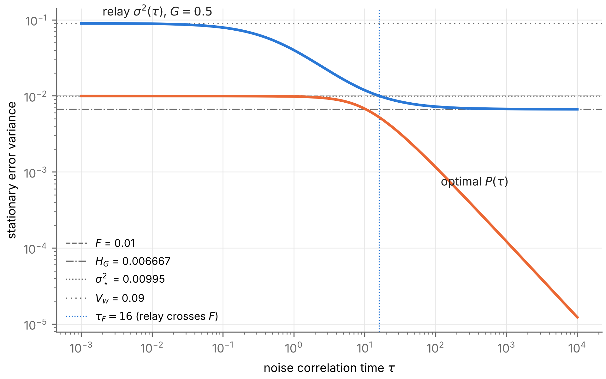

# Task 9 — Stage 2 correlation-time sweep: results

Verifies `classification/Stage_2_Tau_Sweep_Results.md`. Pre-registration `classification/PREREG_t9.md`, commit **2555442**; code and results commit **238c15f**. Total runtime of `run_t9.sh`: **631 s** (Python 3.13.16, NumPy 2.5.3, SciPy 1.18.1, SymPy 1.14.0, mpmath 1.3.0). Generated by `make_results_t9.py` from `results/*.json`.

| Check | Verdict | Measured | Runtime (s) |
|---|---|---|---|
| T9.1 symbolic | **PASS** | 27/27 items reduce to 0, all by `simplify` (no fallback route used) | 1.7 |
| T9.2 optimal filter, ARE route (ε = 1e-4…1e-10, √ε extrapolation) | **FAIL** | 1979/2001 within 1e-5 (median rel. err 1.9e-15); **22 fail**, worst 0.0639; worked example 2.1e-16 | 10.2 |
| T9.2 optimal filter, Wiener route (worked example, τ = 0.1, 1, 10) | **PASS** | rel. err 2.1e-17, 2.0e-17, 1.5e-17 |  |
| T9.3 worked-example values | **PASS** | 10/10 match (9 at 4 s.f., V(1) at 3 s.f.) | 0.8 |
| T9.4 classification tables | **PASS** | 80,000 relay + 12,000 optimal classifications on 2,000 sets (+ 3 boundary-G variants each); 0 class mismatches, 0 endpoint mismatches (max rel. 8.9e-33) | 212.8 |
| T9.5 monotonicity and ordering | **FAIL** | 400,000 samples: relay extrema 0, P extrema 0, P > relay 0, V not strictly decreasing 285, V < P 13 | 203.6 |
| T9.6 adversarial | **PASS** | (a) rationalized worst 2.9e-16 over 2121 linear-case points; (b) float vs mp 1.4e-16, 0 class mismatches; (c) 18 near-critical tolerances, 0 mismatches; (d) G → 0⁺ converges by G = 1e-6; (e) Monte Carlo |z| ≤ 2.34, SE ≤ 0.91% | 23.4 |

**Overall: 2 pre-registered check(s) FAIL (T9.2 optimal filter, ARE route (ε = 1e-4…1e-10, √ε extrapolation); T9.5 monotonicity and ordering); every other check passes.** Both failures are traced to the pre-registered numerical method, not to the document (diagnoses below). No document class changes: every class in Propositions 2.3 and 3.3 is confirmed, and Proposition 3.1 is confirmed by two independent routes.

## T9.2 failure: diagnosis

The ARE route missed Proposition 3.1 by more than 1e-5 in 22 of 2001 cases (worst 0.0639). **The error is in the criterion, not the document.** Post-hoc diagnosis (`t9_filter_diag.py`, not a pass criterion):

- Solving the same 2×2 ARE in mpmath (60 digits, Hamiltonian stable subspace) shows the regularised error P_ε converging to Proposition 3.1 as √ε in every failing case (relative gap falls by 10⁵ per 10¹⁰ in ε). For these parameters the √ε prefactor is large: at ε = 1e-10 the gap is still up to 605× P. The pre-registered absolute ε grid (1e-4…1e-10) is far from the asymptotic regime there, and a cubic in √ε through four such points cannot extrapolate.
- scipy's `solve_continuous_are` also disagrees with the mp solution by up to 7.7e-06 at ε = 1e-10 on these sets.
- Over **all 2001** pre-registered cases: mp ARE at ε = 1e-40 matches Proposition 3.1 to 3.1e-12 (0 over 1e-5); the closed-form causal Wiener filter (same spectral factorization, causal part integrated exactly) matches to 7.7e-50 (0 over 1e-6).
- The pre-registered scaled-ε diagnostic (ε₀ = R_v/(λ + 1/τ)²) did not rescue it either: max rel. err inf, 4 failures (scipy raised errors at the smallest scaled ε).
- Side note: the quadrature-based Wiener code is accurate at the worked example (the pre-registered use) but loses accuracy for λ ≲ 1e-2 (integrand peak of width λ); the closed-form version above has no such problem.

## T9.5 failure: diagnosis

The float64 V(τ) of the pre-registered method was not strictly decreasing at 285 grid steps and fell below P at 13 samples. **The error is in the criterion (float64 resolution), not the document.** Post-hoc diagnosis (`t9_order_diag.py`, not a pass criterion) recomputes V at each flagged sample in mpmath (60 digits; stationary point of σ² in G refined by `findroot` from the float argmin, compared with the G → ∞ limit):

- Not strictly decreasing: **0 of 285 are real.** In mp, V does decrease at every flagged step, by a relative 9.4e-19 to 1.4e-15, i.e. at the level of float64 rounding in σ² and the minimiser (eps = 1.1e-16, a few eps per evaluation). All flagged steps are at λτ ∈ [1.1e-06, 2.0e-04] (white-noise end, where V is nearly flat in τ).
- V < P: **0 of 13 are real.** In mp, (V − P)/P ≥ 3.9e-17 > 0 at every flagged sample (λτ ∈ [1.0e-06, 7.0e-06]).
- So Proposition 3.4's "V strictly decreasing" and "P ≤ V" hold at every sample once V is computed with enough precision. The pre-registered float64 method cannot resolve differences below ~1e-16 relative, which occur near λτ → 0.

## Wording and formula points in the document

1. **Proposition 3.1 proof, "multiplying by τ² gives the quadratic".** The Riccati right-hand side must be multiplied by **−τ²R_v**. Multiplying by τ² alone leaves `-(2*Pi*Sigma*tau**2 + Pi*tau**2 + 1)*(P**2*Pi*lambda**2*tau**2 - 2*P**2*Pi*lambda*tau + P**2*Pi + 4*P*Pi*Sigma*tau + 2*P*lambda - 2*Sigma)/(Pi*(2*Pi*Sigma*tau**2 + 1))` ≠ 0. The quadratic and P(τ) are correct; only the sentence is wrong.
2. **Proposition 2.2 proof, "approach directions follow from C4 for a decreasing function".** The stated directions (V_w from below, H_G from above) are correct under the C4 *definition*, but the C4 *parenthetical* (reversed, Task 8) would give the opposite. Fixing the C4 parenthetical fixes this.
3. **Worked example, σ²(10) = 0.011875** is exactly halfway between 0.01187 and 0.01188; it matches "0.01188" only at the half-unit boundary of the 4 s.f. rule.
4. **Proposition 3.4, "about 0.00990"**: V(1) = 0.009900988 (best constant gain G ≈ 0.0201), so P(1) = 0.0098039 < V(1) as stated.

No formula error was found. No class changes.

## Numerical result (T9.5, recorded, not a pass/fail on the document)

Over 400,000 (set, τ) samples the pre-registered float64 computation gives min(V − P) = -6.78e-21 and min (V − P)/P = -1.9e-16, so **V − P ≤ 0 does occur in float64** (13 samples, all at λτ ≤ 7e-6). Recomputed in mp, those samples have (V − P)/P ≥ 3.9e-17 > 0. Answer to the document's open question: **no sample has V ≤ P once V is computed in 60-digit arithmetic; P < V strictly at every sample.** The gap shrinks towards 0 as λτ → 0 (both tend to σ*²), so this is numerical evidence for strictness, not a proof.

## Bugs and limitations in the Task 9 code

- No code bug changed any verdict. While writing `t9_filter_diag.py` the study code in `t9_filter.py` was wrapped in `main()` so the functions could be imported; results are identical.
- `t9_classify.py` was extended (after a 10-set timing run, before the full run) to count limit-check failures by sweep and endpoint; no verdict logic changed.
- The pre-registered endpoint-limit check (L at 1e∓80/λ vs 1e∓70/λ, 1e-40 relative) is ill-posed for a zero limit. It "fails" for the optimal filter's L₊ = 0 in every set ({'optimal L-': 0, 'optimal L+': 2000, 'relay L-': 0, 'relay L+': 0}); P(1e80/λ) ≤ 1.2e-77 confirms the limit is 0. Not used by any verdict.
- V(τ) bracketing found more than one grid-local minimum of σ²(G) in 222,152 samples. These are float64 plateaus at G ≳ 1e16 where σ² equals 1/(2Πτ) to machine precision, not real minima; V takes the minimum with that limit anyway.

## Linear case (T9.6(a))

The rationalized form stays at machine precision through λτ = 1 (worst 2.9e-16). The naive root (−b + √D)/(2(1 − λτ)²) has relative error > 1e-6 for |1 − λτ| up to 1e-04 (100% error for |1 − λτ| ≤ 1e-7, 0/0 at λτ = 1).

## Monte Carlo (T9.6(e))

| τ | filter | MC | SE | formula | z |
|---|---|---|---|---|---|
| 0.1 | relay | 0.0798532 | 0.00052 (0.65%) | 0.0791304 | +1.40 |
| 0.1 | optimal | 0.00998716 | 7e-05 (0.70%) | 0.0099401 | +0.67 |
| 1.0 | relay | 0.0401118 | 0.00036 (0.91%) | 0.04 | +0.31 |
| 1.0 | optimal | 0.00976151 | 6.7e-05 (0.68%) | 0.00980392 | -0.64 |
| 10.0 | relay | 0.0119843 | 4.7e-05 (0.39%) | 0.011875 | +2.34 |
| 10.0 | optimal | 0.00681029 | 2e-05 (0.30%) | 0.0067813 | +1.44 |

## Figure

*Relay σ²(τ) at G = 0.5 and optimal P(τ) at λ = 1, Σ = 0.01, Π = 1. The relay falls from V_w to H_G and crosses F at τ_F = 16; P falls from σ*² towards 0 like 1/τ.*

Runtime per script (s): t9_symbolic 1.7, t9_filter 10.2, t9_filter_diag 22.3, t9_values 0.8, t9_classify 212.8, t9_order 203.6, t9_order_diag 154.7, t9_adversarial 23.4, t9_figure 1.4
